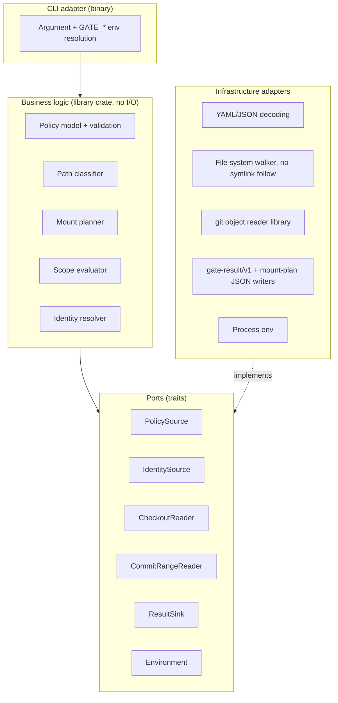

# Architecture

agent-gate follows clean architecture. The business logic is pure. It depends only on
abstractions (ports), never on the file system, git, serialisation formats or the CLI.



## Business logic

All of this is pure, deterministic and free of I/O.

| Concept | Operation |
| --- | --- |
| **Policy** | `validate(raw document) → Policy \| PolicyInvalid`: expands `@name` and compiles globs. Holds roles, zones and the digest |
| **Path classifier** | `classify(policy, role, path) → Access`. Applies the protected floor and the precedence ([ADR-0002](../adr/ADR-0002-roles-from-the-harness.md)). `could_contain(policy, role, dir, access)` answers whether some path below a directory could have the given access, for directory entries |
| **Mount planner** | `plan(policy, role, narrowing, entries) → MountPlan`. Turns enumerated checkout entries into sorted plan entries and collapses absent subtrees |
| **Identity resolver** | `resolve(identity_map, author, committer) → Role \| IdentityViolation` |
| **Scope evaluator** | `evaluate(policy, attribution, commits with changed entries) → ScopeReport`. Attribution is either the identity map or a fixed role (pre-push). Applies the per-rule checks and orders the violations |
| **Report mapping** | `ScopeReport \| Error → CheckOutcome` (status, summary, findings, metrics), with the caps applied |

Business-logic types: `RoleName`, `Zone`, `RepoPath` (validated UTF-8, `/`-separated, no `..`),
`RawPath` (bytes from git), `Glob`, `Access`, `EntryKind`, `CommitId`, `ChangedEntry` (old and new
path and mode, change kind), `Violation`, `ViolationRule`, `ScopeReport`, `MountPlan` and
`CheckStatus`.

## External system interfaces (ports)

| Port | Provides | Notes |
| --- | --- | --- |
| `PolicySource` | Raw roles document bytes, plus the source kind (`pack` or `repository`) | Size-capped |
| `IdentitySource` | Raw identity map bytes | Size-capped |
| `CheckoutReader` | Iterator of `(RawPath, EntryKind)` for the checkout, excluding `.git/`, never following symlinks | Entry-count cap |
| `CommitRangeReader` | Resolve `base` and `head`; check ancestry; iterate commits in the range in topological order, with author and committer emails, parent IDs and changed entries per parent | Commit and path caps. Missing objects give `HistoryIncomplete` |
| `ResultSink` | Write a gate result or a mount plan | Atomic write (temporary file and rename) where a file is the target |
| `Environment` | The `GATE_*` variables; canonicalising paths to check workspace containment | Only the CLI uses it |

## Infrastructure implementations (adapters)

| Adapter | Implements | Key rules |
| --- | --- | --- |
| YAML decoder | Decoding for `PolicySource` and `IdentitySource` | Rejects duplicate keys, anchors and aliases, tags, and multi-document streams |
| File system walker | `CheckoutReader` | `lstat` only; never follows symlinks; sorted output not required (business logic sorts) |
| Git reader | `CommitRangeReader` | Library-based (gix proposed). Never spawns `git`. Ignores repository config, attributes, hooks and filters. Rename detection is off: a rename shows up as a delete plus an add, which already means both paths are checked |
| JSON writers | `ResultSink` | Canonical key order; no trailing whitespace variation |
| Process environment | `Environment` | |

## Main flows

### Mount plan (sandbox-runner)

```mermaid
sequenceDiagram
  participant SR as sandbox-runner (host)
  participant AG as agent-gate
  SR->>SR: prepare checkout at stage base commit
  SR->>AG: mount-plan --roles R --role builder --checkout D [--writable-paths …]
  AG->>AG: validate policy; enumerate D (no symlink follow)
  AG->>AG: classify each entry; derive dir access; collapse absent
  AG-->>SR: mount-plan:1 JSON (exit 0) or error (exit 2)
  SR->>SR: materialise workspace per plan; boot microVM
```

### Scope check (gate-warden)

```mermaid
sequenceDiagram
  participant GW as gate-warden sandbox
  participant AG as agent-gate scope-check
  GW->>AG: env GATE_* (no args)
  AG->>AG: resolve inputs from GATE_HARNESS_DIR / GATE_DEFAULT_BRANCH_DIR
  AG->>AG: refuse inputs inside GATE_WORKSPACE
  AG->>AG: validate policy + identity map
  AG->>AG: walk GATE_BASE_SHA..GATE_HEAD_SHA; per commit: resolve role, changed paths, violations
  AG-->>GW: gate-result/v1 to GATE_RESULT_FILE; exit 0/1/2
```

### Scope pre-check (sandbox-runner, before push)

`scope-check --roles R --as-role builder --range <stage-base>..<agent-head> --repo <host clone>
--result-file F`. sandbox-runner pushes only on exit `0`. It sets the author and committer to the
role's App identity before pushing (AS-11).

## Dependency rule

- The business-logic crate depends on no file system, git, serde format, CLI or process crate.
  A cargo-deny ban list enforces this.
- Adapters depend on the business logic, never the other way round.
- Library consumers such as sandbox-runner may supply their own port implementations.
