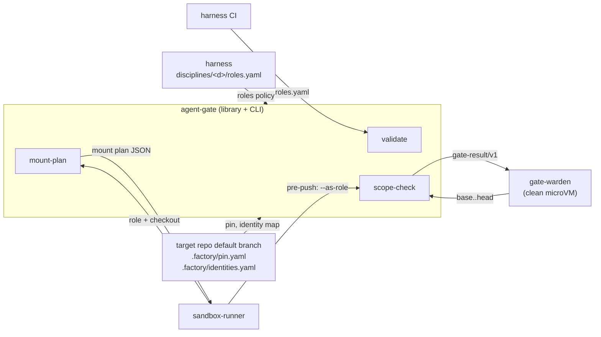

# Overview

## Purpose

agent-gate enforces **which role may write where**, from a single policy. It is the single
source of the visibility and write matrix in handbook `docs/architecture/agent-profiles.md`.

## System context

| Actor | Uses agent-gate for | Trust |
| --- | --- | --- |
| sandbox-runner | Mount plan before boot; scope pre-check before push | Trusted caller, outside the microVM |
| gate-warden | Authoritative scope check (the `scope-check` check of G6-lite and later G6/G7) | Trusted caller; the workspace it passes is untrusted |
| harness CI | Validating `roles.yaml` changes | Trusted caller |
| Humans (L2, optional) | Local hooks giving fast feedback | Advisory only |

## Enforcement layers

agent-gate takes part in three of the six layers listed in handbook
`docs/architecture/isolation-and-security.md`:

1. **gate-warden scope check.** Authoritative. agent-gate provides the CLI.
2. **Push rulesets.** Generating them is after the factory role is complete.
3. **Sandbox mount plan.** agent-gate produces it; sandbox-runner applies it.
4. **In-sandbox feedback.** Optional hooks (L2).

## Scope by level

### L1 (M1, human-led)

- Read harness-defined roles (`oracle`, `builder` at first). No role names are hard-coded except
  the reserved `human`.
- Strict policy validation (`validate`).
- `mount-plan`: role plus checkout gives an enumerated JSON plan.
- `scope-check`: `base..head` plus identity map gives a `gate-result/v1` document and an exit code.
- A gate-warden mode that takes its inputs from `GATE_*` environment variables and trusted trees.
- Rust library plus CLI. All shell scripts and experiment files are removed.

### L2 (M2, factory-built)

- Ownership, `0444` mode and sticky `1775` directory attributes in mount plans for colocated
  locked files.
- A repository-level `.factory/roles.yaml` that replaces the pack roles (needed by the harness as
  a run target from M3).
- Optional `check-path` command and hook configuration for human-led use.
- Boundaries only. Quality checks belong to commit-gate and gate-warden. This holds by design,
  because the experiment's check pipeline is not carried forward
  ([ADR-0008](../adr/ADR-0008-boundaries-only.md)).

### After the factory role is complete

- Generating push rulesets that restrict file paths, where the GitHub plan supports it.
- Commit signature verification for identity attribution, with chain-chronicler.
- Later roles (`designer`, `reviewer`, `health`, `harness-author`) need no agent-gate change.
  They are harness policy.

## Non-goals

- Running quality, build or test checks.
- Deciding pass or fail for a PR or a gate. The scope-check result is one input to gate-warden.
- Holding or calling any credential, network service or GitHub API.
- Applying mounts. sandbox-runner does that.
- Being writable by any agent role. Policy and configuration live in the harness and in
  `.factory/`.
- Oracle integrity (manifest hashes, config guard). oracle-guard does that. agent-gate only
  checks which paths a role touched.
